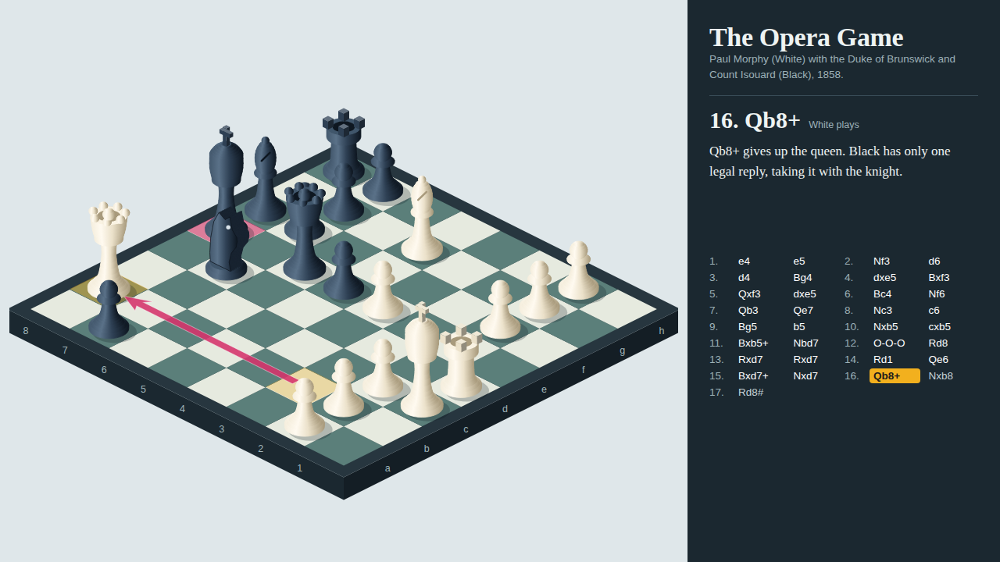
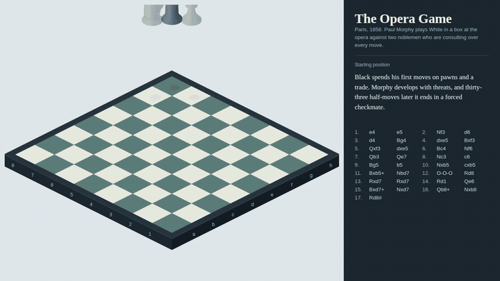
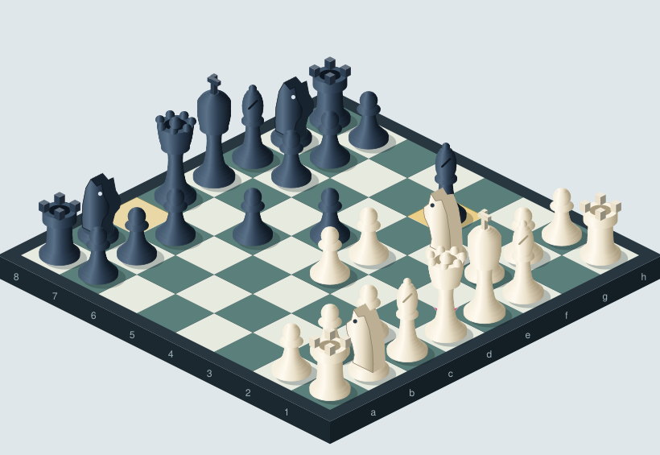
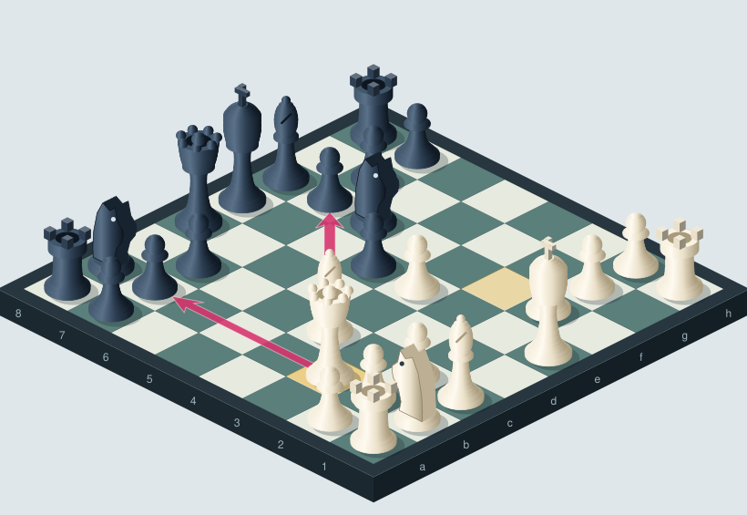
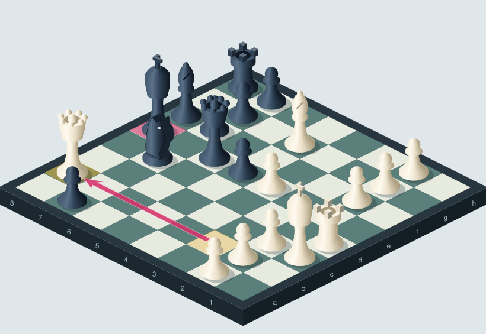
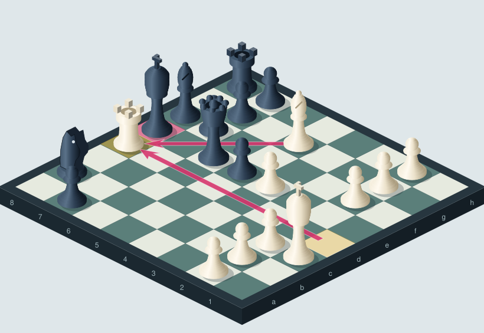

# Isometric Chess



A chess game, drawn by code. This project replays Paul Morphy's 1858 **Opera Game** on an isometric board, explains the key tactics with arrows and short commentary, and turns the whole thing into an interactive viewer and a 94-second explainer video.

The renderer is written from scratch: no 3D engine, no canvas, no sprites. Every board square, every lathed piece and every arrow is a plain SVG `<path>` or `<polygon>`, about 190 lines of JavaScript.



- **Interactive viewer:** `docs/index.html`, one self-contained file. Space plays and pauses, the arrow keys step through moves, and you can click any move in the list.
- **Explainer video:** `media/opera-game-isometric.mp4`, rendered frame by frame from the same code that powers the viewer.
- **Static figures:** `docs/figures/*.svg`, one per key moment.

| The pin | The double attack |
|---|---|
|  |  |
| **The queen sacrifice** | **Checkmate** |
|  |  |

## Run it

```bash
npm install
npm run build          # writes docs/index.html and docs/figures/*.svg
open docs/index.html   # or serve docs/ with any static server
```

To re-render the video you also need `ffmpeg` and Playwright's Chromium (`pip install playwright && playwright install chromium`):

```bash
npm run video          # writes media/opera-game-isometric.mp4, preview.gif, hero.png
```

## How the renderer works

**Projection.** A 2:1 dimetric projection: `screenX = (x - y) * W/2`, `screenY = (x + y) * W/4 - z * k`. One function, `proj`, is the only place that knows about the camera.

**Lathed pieces.** Pawns, bishops, queens and kings are described as a radius profile, a list of `[height, radius]` points. A Catmull-Rom spline resamples the profile, and each slice becomes a frustum drawn as an SVG path whose silhouette is two elliptical arcs. A horizontal gradient gives each slice its shading. Spheres and eggs (pawn heads, bishop mitres) are just profiles with a circular or elliptical radius function.

**Extruded knight.** The knight is a 2D horse-head silhouette extruded across the board by stacking offset copies of the polygon, with the lit gradient on the front face only.

**Boxes.** Rook merlons and the king's cross share one `box()` helper that draws the three visible faces.

**Depth.** Painter's algorithm, sorted by `x + y`. Pieces hop with a sine lift, captured pieces fade and rise, and the rook slides during castling.

**Game logic.** `chess.js` validates and replays the moves. `src/game.js` tracks each piece's identity across the game, so "this exact knight moved from g1 to f3" can be animated instead of redrawn.

**One timeline, two outputs.** `src/timeline.js` is a pure function from time to scene. The viewer calls it from `requestAnimationFrame`. The video script calls it once per frame through Playwright and pipes the screenshots to ffmpeg. Frames that would be identical (the pauses between moves) are rendered once and reused.

## Layout

```
src/iso.js        projection, primitives, piece models, board, arrows
src/timeline.js   time -> positions, hops, fades, highlights, arrows
src/game.js       chess.js replay with stable piece ids
src/opera.js      the moves and the commentary
src/viewer.html   viewer template (engine and data are inlined at build time)
scripts/build.js  builds docs/
scripts/render_video.py  renders media/
```

## Use your own game

Replace `SANS` and `NOTES` in `src/opera.js` with any game written in standard algebraic notation, then run `npm run build`. Notes are keyed by ply and can carry `arrows` (`[['c4','f7']]`) and `marks` (`['b5']`).

## Credits

The moves of the Opera Game are public domain. The commentary and all code in this repository are original. MIT licensed.
